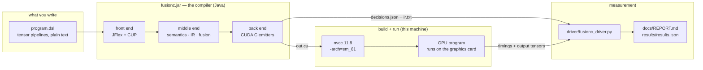
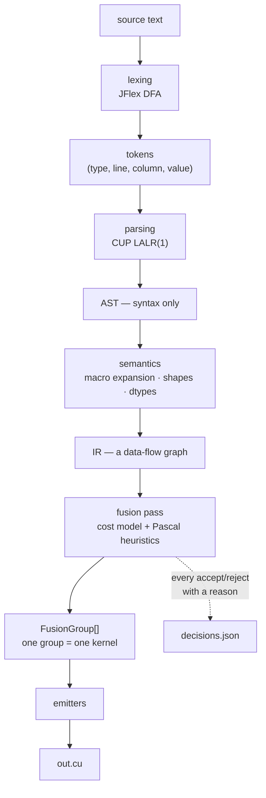
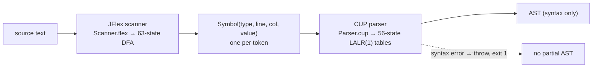
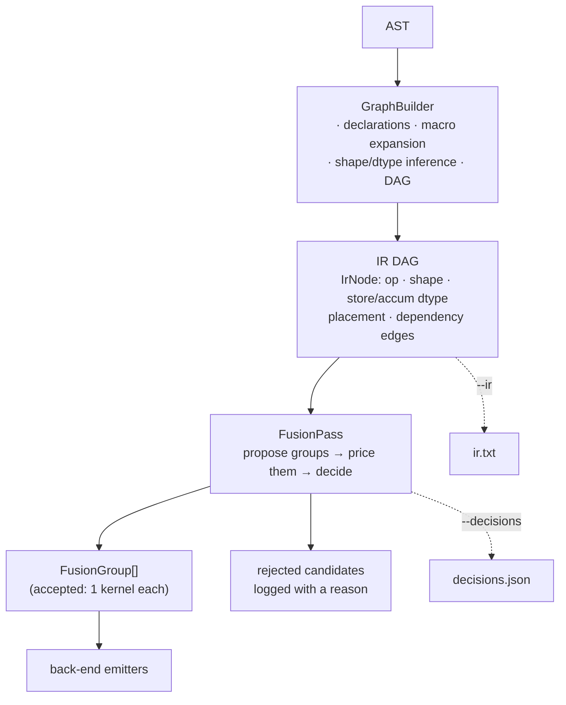
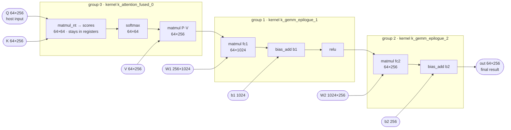
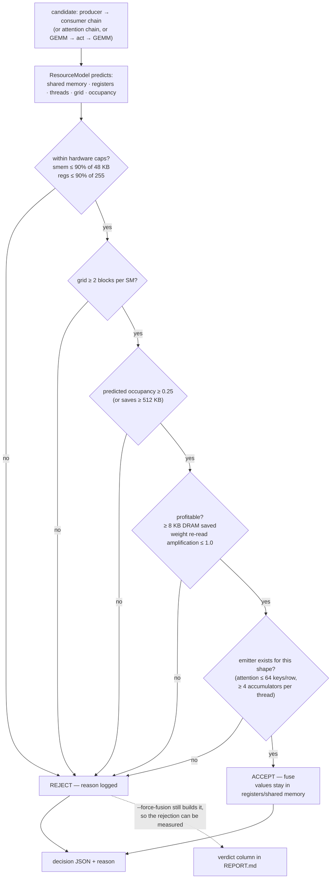
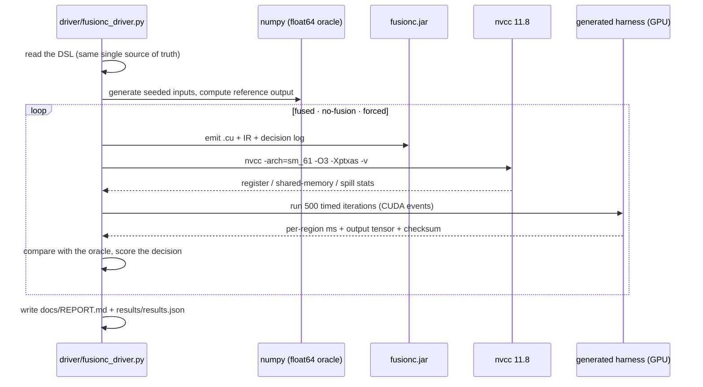
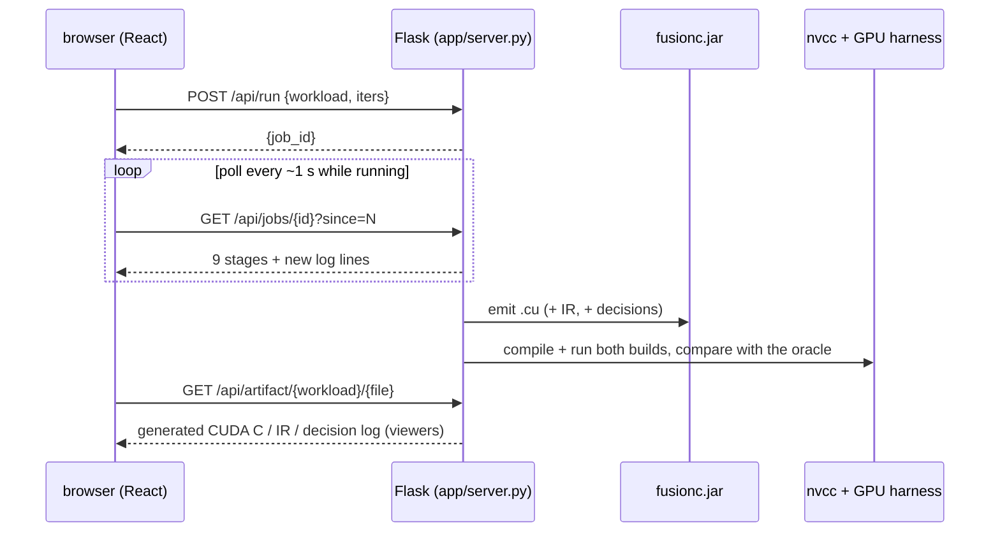
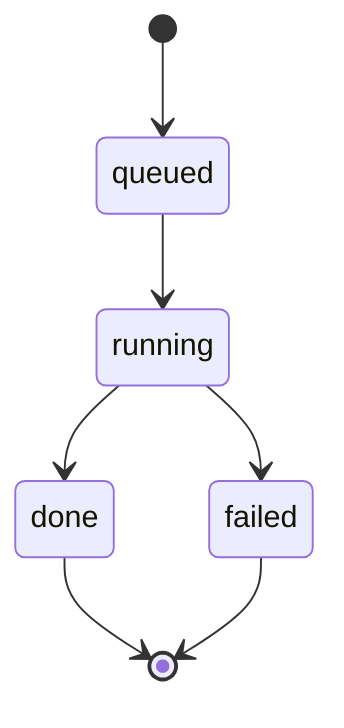

# FusionC

**A source-to-source compiler that turns a small tensor-pipeline DSL into fused CUDA C for
consumer Pascal GPUs** (`sm_61`: GTX 1050 Ti / GTX 1070 — no Tensor Cores, no `cp.async`, no
BF16, 48 KB shared memory per block, 255 registers per thread, CUDA 11.x toolchain).

```
out = attention(Q, K, V) -> MLP(W1, relu, W2, b1, b2);
```

becomes, with `--fuse`, three GPU kernels instead of eight — and the fused kernels are
generated from the IR, never hand-written.

This is a semester project for a Compilers course. Everything in it is measured on a real GPU
and every optimisation decision is logged, so nothing has to be taken on faith.

---

## Contents

1. [The one-page summary](#1-the-one-page-summary)
2. [The big picture — what happens end to end](#2-the-big-picture)
3. [Quick start](#3-quick-start)
4. [The language](#4-the-language)
5. [Compiler internals, pass by pass](#5-compiler-internals)
6. [Data structures](#6-data-structures)
7. [The generated CUDA C](#7-the-generated-cuda-c)
8. [The fusion decision — the core idea](#8-the-fusion-decision)
9. [Evaluation pipeline and measured results](#9-evaluation-pipeline-and-measured-results)
10. [The web dashboard](#10-the-web-dashboard)
11. [Repository specification](#11-repository-specification)
12. [File formats](#12-file-formats)
13. [Command reference](#13-command-reference)
14. [Viva cheat sheet](#14-viva-cheat-sheet)
15. [Pascal-specific design decisions](#15-pascal-specific-design-decisions)
16. [Limitations and future work](#16-limitations-and-future-work)
17. [Appendix A — toolchain notes (this machine)](#appendix-a--toolchain-notes)

---

## 1. The one-page summary

* **Input:** a 10-line DSL program describing a tensor graph (tensors + pipelines).
* **Output:** a self-contained `.cu` file — GPU kernels + memory plan + a host program that
  loads inputs, times everything and dumps results.
* **In between:** JFlex lexer → CUP LALR parser → AST → shape/dtype inference with composite-op
  expansion → 15-node IR DAG → fusion pass with a Pascal resource cost model → CUDA C emitter.
* **The optimisation:** producer→consumer operations are fused so intermediate values stay in
  registers / shared memory instead of round-tripping through DRAM, and fewer kernel launches
  are needed.
* **The proof:** 3 workloads × 3 build modes + 1 hand-written reference = **10 compiled
  variants, all matching a float64 oracle element-wise**, 1.06×–1.30× fused-vs-naive speedups,
  zero register spills, and every fusion decision — accepted *and* rejected — measured and
  scored. Full tables: [`docs/REPORT.md`](docs/REPORT.md).

**Where things live (30-second orientation):**

| you want to… | go to |
|---|---|
| read the language definition | [`docs/DSL_SPEC.md`](docs/DSL_SPEC.md), §4 below |
| see the lexer / grammar | `src/main/jflex/Scanner.flex`, `src/main/cup/Parser.cup` |
| see the compiler logic | `src/main/java/io/fusionc/` (§5, §6) |
| compile something | `java -jar build/fusionc.jar --input examples/attention_mlp.dsl --fuse -o out.cu` |
| watch the whole pipeline live | `.\scripts\start_demo.ps1` → <http://localhost:5173> (§10) |
| see the measurements | [`docs/REPORT.md`](docs/REPORT.md), `results/results.json` |
| run the full evaluation | `python driver/fusionc_driver.py` |

---

## 2. The big picture



Read it left to right: **text goes in, GPU program comes out**, and everything the compiler
decides on the way (including what it *refuses* to do) is recorded and fed into the measurement
that produces the report.

Inside the compiler, the flow is the classic one:



---

## 3. Quick start

```powershell
# 1. build the compiler            (JFlex + CUP + javac -> build/fusionc.jar)
.\scripts\build.ps1

# 2. compile the reference program
java -jar build/fusionc.jar --input examples/attention_mlp.dsl --fuse -o build\attn_fused.cu

# 3. look at the generated GPU code (open build\attn_fused.cu), or ask for the logs:
java -jar build/fusionc.jar --input examples/attention_mlp.dsl --fuse `
     --ir build\attn.ir.txt --decisions build\attn.decisions.json -o build\attn_fused.cu

# 4. compile that CUDA file and run it on the GPU
#    (the evaluation driver does this for you, step 5)

# 5. full measured evaluation -> docs/REPORT.md + results/results.json
python driver/fusionc_driver.py

# 6. the live dashboard (browser front end for everything above)
.\scripts\start_demo.ps1            # then open http://localhost:5173
```

Requirements: JDK 11+, Python 3 with `numpy` (and `flask` for the dashboard), Node/npm for the
dashboard front end, CUDA 11.8 + a supported MSVC toolset for compiling the *generated* code.
The JFlex/CUP jars are already in `tools/`.

---

## 4. The language

Implemented by `src/main/jflex/Scanner.flex` (lexer) and `src/main/cup/Parser.cup` (grammar),
which the build turns into `Scanner.java`, `parser.java` and `sym.java` under
`build/generated/io/fusionc/frontend/`.

### 4.1 A complete example

`examples/attention_mlp.dsl` — the reference workload:

```
const SEQ = 64;                 // compile-time constants
const D   = 256;
const F   = 1024;

dtype fp16 store fp32 accum;    // numeric policy: fp16 in memory, fp32 arithmetic

input Q  : fp16 [SEQ, D];       // host-supplied inputs
input K  : fp16 [SEQ, D];
input V  : fp16 [SEQ, D];

param W1 : fp16 [D, F];         // host-supplied weights / biases
param b1 : fp32 [F];
param W2 : fp16 [F, D];
param b2 : fp32 [D];

out = attention(Q, K, V) -> MLP(W1, relu, W2, b1, b2);   // one pipeline
```

### 4.2 Lexical structure (JFlex scanner)

| category | tokens |
|---|---|
| keywords | `const` `dtype` `store` `accum` `input` `param` `fp16` `fp32` |
| punctuation | `= ; , : ( ) [ ] ->` |
| literals | `INT` = `[0-9]+` · `FLOAT` = `1.5`, `2e-3`, `1.5e+2` · `IDENT` = `[A-Za-z_][A-Za-z0-9_]*` |
| comments | `// …` line · `# …` line · `/* … */` block |
| whitespace | skipped |

Keywords are lowercase and case-sensitive. The scanner runs in JFlex `%cup` mode: `next_token()`
returns `java_cup.runtime.Symbol` objects carrying `(type, line, column, value)` with 1-based
line/column. Any illegal character is a hard error — `lexical error at line 3, column 7:
illegal character '@'` — and the compiler exits with status 1. It never guesses.

### 4.3 Grammar

The full BNF, exactly as in `Parser.cup`:

```
program    ::= decl_list stmt_list ;

decl_list  ::= decl_list decl | /* empty */ ;
decl       ::= CONST  IDENT EQ INT SEMI
             | DTYPE  datatype STORE datatype ACCUM SEMI
             | INPUT  IDENT COLON datatype dims SEMI
             | PARAM  IDENT COLON datatype dims SEMI ;
datatype   ::= FP16 | FP32 ;
dims       ::= LBRACKET expr_list RBRACKET ;

stmt_list  ::= stmt_list stmt | /* empty */ ;
stmt       ::= IDENT EQ stage_list SEMI ;
stage_list ::= stage_list ARROW stage | stage ;
stage      ::= IDENT LPAREN arglist RPAREN | IDENT ;
arglist    ::= expr_list | /* empty */ ;

expr_list  ::= expr_list COMMA expr | expr ;
expr       ::= INT | FLOAT | IDENT | LPAREN expr RPAREN ;
```

Two structural facts worth pointing at in a viva:

* A program is **declarations first, then statements** (`program ::= decl_list stmt_list`);
  constants and tensors can never be used before they are declared.
* **Statements** are pipeline bindings; **expressions** appear only inside tensor dimensions
  (`dims`) and operation arguments (`arglist`). There are no infix operators, so the expression
  grammar needs **no precedence table** — the only associativity is the `->` chain, which is
  left-associative because `stage_list` is left-recursive. CUP builds this into **22 terminals,
  12 non-terminals, 26 productions, 56 LALR(1) parse states — 0 conflicts, 0 warnings** (the
  build prints that summary on every run).

### 4.4 Semantics and error handling

The parser checks *syntax* only; `io.fusionc.semantics.GraphBuilder` then performs, in order:

1. **Constant table** — duplicates and non-positive values rejected.
2. **Tensor declarations** — duplicate names rejected; every tensor is 1-D (bias/gain vector)
   or 2-D (matrix), row-major; dimensions resolve through the constant table.
3. **Numeric policy** — `dtype fp16 store fp32 accum;` sets default storage and accumulate
   dtypes; a tensor may override storage (`param b1 : fp32 [F];`).
4. **Pipeline expansion** — composites are macros:
   `attention(Q,K,V)` → `scores = matmul_nt(Q,K)` (with `1/√D` folded into the epilogue),
   `softmax`, `matmul(P,V)`; `MLP(W1, act, W2, b1, b2)` → `matmul`, `bias_add`, activation,
   `matmul`, `bias_add`. The IR only ever contains primitives.
5. **Shape and dtype inference** — bottom-up, hard error on any mismatch (attention head dims,
   K/V key counts, MLP feature/hidden dims, bias sizes, matmul inner dims, argument counts).
6. **DAG construction** — nodes carry shape, storage/accumulate dtype, memory placement and
   dependency edges.

**The compiler fails loudly.** Unknown operations list what *is* supported:

```
$ java -jar build/fusionc.jar --input examples/unsupported.dsl --fuse -o build/out.cu
error: unsupported op 'conv2d' -- no emitter exists for it (the compiler refuses to guess);
       supported ops are: attention, MLP, matmul, matmul_nt, bias, relu, gelu, softmax, add,
       scale, layernorm
(exit status 1, no output file written)
```

Syntactic errors behave the same way, with position info — `syntax error at line 12, column 8:
unexpected 'while'` — and CUP's `syntax_error` hook throws, so **no partial AST is ever handed
to the next stage**.

### 4.5 Input and output of a program

| level | syntax | meaning |
|---|---|---|
| program inputs | `input Q : fp16 [SEQ, D];` | host-supplied tensor, loaded from `Q.bin` at run time |
| program parameters | `param W1 : fp16 [D, F];` | also host-supplied; the distinction is documentation, preserved in the IR |
| program output | `out = … ;` | every pipeline binds a result tensor; the last pipeline is the graph output |

Tensors are raw little-endian `fp16`/`fp32`, row-major, one file per tensor.

---

## 5. Compiler internals

### 5.1 Front end (lexing + parsing)



The scanner is generated into `io.fusionc.frontend.Scanner`, the parser into
`io.fusionc.frontend.parser`; `DslParser` connects them (`new parser(new Scanner(reader))`).
`--dump-tokens` prints the token stream; `--dump-ast` prints the tree.

### 5.2 Middle end (semantics → IR → fusion)



### 5.3 The IR graph of the reference workload

`attention_mlp` becomes 15 nodes: 7 host tensors + 8 operations. The three accepted fusion
groups are the boxes (the rejected GEMM→GEMM candidate is described in §8):



Everything inside a group never touches DRAM (it lives in registers or shared memory); only the
group boundaries are written to memory. The IR dump (`--ir`) shows exactly this, one row per
node, with a `group` column and a “(fused, no DRAM buffer)” marker.

### 5.4 Back end (code generation)

`CudaEmitter` walks the groups and picks an emitter by `GroupKind`:

| group kind | emitter | what it writes |
|---|---|---|
| `SINGLE` | `GemmKernels`, `ReduceKernels`, `ElementwiseKernels` | one kernel per operation (the `--no-fusion` baseline) |
| `ELEMENTWISE_FUSED` | `ElementwiseKernels` | a chain of elementwise ops in one kernel |
| `GEMM_EPILOGUE` | `GemmKernels` + `Epilogue` | matmul whose accumulator tile is consumed in registers by bias/activation |
| `ATTENTION_FUSED` | `AttentionKernel` | QKᵀ → softmax → PV, one kernel, K/V staged in shared memory |
| `GEMM_GEMM_FUSED` | `MlpKernel` | MLP where the hidden tile is produced into shared memory and consumed in place |

Then the emitter writes the **static memory plan** (one allocation per tensor, shared-memory
stage buffers overlaid so they are recycled) and the **host harness** (loads `.bin` inputs,
warms up, times every region with CUDA events, prints `KERNELATTR`/`REGION`/`TOTAL`/`CHECKSUM`
lines, dumps the output tensor).

---

## 6. Data structures

### 6.1 AST (`io.fusionc.ast.Ast`) — syntax only

| class | fields | notes |
|---|---|---|
| `Program` | `List<Decl> decls`, `List<Pipeline> pipelines` | declarations precede statements |
| `ConstDecl` | `name`, `value` | `const SEQ = 64;` |
| `DtypeDecl` | `store`, `accum` | numeric policy |
| `TensorDecl` | `name`, `dtype`, `dims:List<Expr>`, `input` | `input`/`param` |
| `Pipeline` | `output`, `stages:List<Stage>` | one statement |
| `Stage` | `Name(name)` or `Call(op, args:List<Expr>)` | a pipeline step |
| `Expr` | `IntLit(value)` / `FloatLit(value)` / `Ref(name)` | dims and arguments |

### 6.2 IR (`io.fusionc.ir`) — everything the compiler knows

| field (class) | type | meaning |
|---|---|---|
| `IrNode.id`, `.name`, `.op` | int, String, `OpKind` | identity |
| `IrNode.inputs`, `.consumers` | `List<IrNode>` | the DAG edges (producers / consumers) |
| `IrNode.shape` | `Shape(rows, cols)` | row-major 2-D shape |
| `IrNode.store`, `.accum` | `DType` (`FP16`/`FP32`) | memory dtype vs arithmetic dtype |
| `IrNode.placement` | `MemSpace` (`GLOBAL`/`SHARED`/`REGISTER`) | where the value lives during the kernel |
| `IrNode.materialized` | boolean | false ⇒ the value never gets a DRAM buffer (fused away) |
| `IrNode.group` | int | fusion-group id, `-1` = standalone |
| `IrNode.attrs` | map | `transB`, `scale`, `hostTensor`, `pipeline`, `origin` |
| `IrGraph.nodes / byName / outputs / namedOutputs` | lists/maps | nodes are in topological creation order |

`OpKind` (the primitives, composites are already expanded):

| op | kind | meaning |
|---|---|---|
| `INPUT`, `PARAM` | leaf | host-supplied tensors |
| `MATMUL` | reduction | `A·B` (attr `transB` selects `A·Bᵀ`) |
| `SOFTMAX`, `LAYERNORM` | reduction | row-wise over the last dimension |
| `BIAS_ADD`, `RELU`, `GELU`, `SCALE`, `ADD` | elementwise | epilogue-friendly ops |

### 6.3 Fusion structures (`io.fusionc.pass`)

| class | fields | meaning |
|---|---|---|
| `FusionGroup` | `id`, `kind:GroupKind`, `members`, `external`, `internal`, `params`, `decision` | one scheduled kernel; `external` = written to DRAM, `internal` = stays inside |
| `FusionDecision` | `groupId`, `kind`, `accepted`, `members`, `predicted{smemBytes, regsPerThread, occupancyMilli, gridBlocks, …}`, `metrics{bytesSaved, launchesSaved}`, `gridBlocks`, `bytesSaved`, `reason` | the JSON-logged record of one accept/reject |
| `ResourceModel.Est` | `threads`, `smemBytes`, `regsPerThread`, `gridBlocks`, `occupancy` | the cost model's prediction (same numbers ptxas later reports) |

### 6.4 Every tunable in one file (`PascalHeuristics`) — the anti-magic-number rule

No compiler constant exists outside this class, and each carries the Pascal fact that justifies
it. The main ones:

| constant | value | why |
|---|---|---|
| `MAX_SMEM_BYTES_PER_BLOCK` | 48 KB | sm_61 static shared-memory limit (no opt-in) |
| `SMEM_BYTES_PER_SM` | 96 KB | unified L1/shared per SM |
| `MAX_REGS_PER_THREAD` / `REGS_PER_SM` | 255 / 65 536 | architecture limits |
| `MAX_THREADS_PER_BLOCK` / `_PER_SM` | 1024 / 2048 | occupancy bounds |
| `WARP_SIZE`, `SMEM_BANK_BYTES` | 32, 4 B | shuffle width, bank conflicts |
| `FP16_MATH_RATE_DIVISOR` | 64 | GP10x FP16 math runs at 1/64 FP32 rate — hence storage-only halves |
| `GEMM_BM/BN/BK`, `GEMM_TILES` | 64×64, then 64×32 → 32×64 → 32×32 | tile chooser steps down while the grid is too small |
| `GEMM_TILE_MIN_BLOCKS` | 4 | below this the kernel cannot fill a 16-SM part |
| `ATTN_DIM_CHUNK`, `ATTN_ROWS_PER_BLOCK` | 64, 2 | shared-memory budget of the fused attention kernel |
| `MLP_RM/CN/BK/HF` | 32 / 64 / 32 / 128 | fused MLP tile (34 KB shared memory) |
| `SMEM_SAFETY_MARGIN`, `REG_SAFETY_MARGIN` | 0.90 | fuse only while predicting ≤90% of the caps |
| `MIN_PREDICTED_OCCUPANCY` | 0.25 | occupancy floor (overridable by big traffic savings) |
| `OCCUPANCY_OVERRIDE_SAVING_BYTES` | 512 KB | the override threshold |
| `MIN_GLOBAL_BYTES_SAVED` | 8 KB | below this, fusing is not worth any register cost |
| `MIN_GRID_BLOCKS_PER_SM` | 2 | fused kernels must still fill the device |
| `MAX_PRODUCER_REREAD_AMPLIFICATION` | 1.0 | a fusion that re-streams weights more often than the baseline loses |
| `MAX_EPILOGUE_CHAIN` | 4 | limit on chained elementwise epilogues |
| `REG_BASE_OVERHEAD`, `LAUNCH_COST_US` | 32, 4.0 | register overhead; per-launch cost for decision logging |

---

## 7. The generated CUDA C

One self-contained translation unit per build. Its structure, top to bottom
(example: `results/attention_mlp/attention_mlp_fused.cu`):

1. **header comment** — source name, mode, target, the Pascal constraints baked in;
2. **device helpers** — warp shuffles (`fx_warp_max/sum`, block reductions), GELU, fp16
   helpers, `FX_CUDA_CHECK`;
3. **the kernels**, one per fusion group, each preceded by a comment stating its tiling and
   shared-memory budget:

   ```c
   // kernel 0: attention_fused -- QK^T*scale -> softmax -> PV, one kernel
   //   64 query rows x 256 head dim; 2 rows/block (1 warp each), 4 dimension chunks of 64
   //   shared per stage: K 4224 halves (padded) overlaid with V 4096 floats, x2 stages
   typedef union { __half h[4224]; float f[4096]; } fx_stage0_t;
   __global__ void k_attention_fused_0(__half* __restrict__ T_out_attn_pv,
                                       const __half* __restrict__ P_Q, ...) { ... }
   ```

4. **the static memory plan** — one allocation per tensor, shared-memory stage unions overlaid
   so buffers are recycled between phases;
5. **the host harness** — loads `.bin` inputs, runs warm-up + timed iterations, times every
   region with CUDA events, prints machine-readable lines and dumps the output tensor.

Compile and run it exactly as the report does:

```
nvcc -arch=sm_61 -O3 -Xptxas -v results/attention_mlp/attention_mlp_fused.cu -o attn_fused.exe
```

Design constraints visible in every kernel: FP16 **storage** with FP32 **accumulation**; no
`cp.async` (cooperative global→shared copies + `__syncthreads()`; the fused attention kernel
issues the next chunk's loads *before* the current chunk's FMAs — the Pascal stand-in for an
async copy); warp-level reductions so row reductions never touch DRAM; padded shared memory so
strided attention reads do not bank-conflict.

---

## 8. The fusion decision

This is the heart of the project: the compiler proposes fusions, prices them, and either takes
them or rejects them **with a written reason**. Nothing is heuristic guesswork that goes
unrecorded.



Real example from the reference workload — the rejected GEMM→GEMM fusion:

```
REJECT gemm_gemm_fused   out.mlp_fc1 + out.mlp_b1 + out.mlp_act + out.mlp_fc2
       predicted: smem=21.0KB regs=50 occupancy=0.50 grid=32 dram_saved=512.0KB
       reason   : rejected: candidate tile 8x64 leaves only 2 accumulator registers per
                  thread (< 4): the inner loop would be shared-memory bound; keeping 4
                  unfused kernels (the 512.0 KB of DRAM traffic saved does not compensate
                  for the lost parallelism)
```

…and the measurement that proves the rejection was right: when that same fusion is forced into
the build anyway (`--force-fusion`), it runs **51.6%–188% slower** than the unfused kernels it
would have replaced (§9.4). The evaluations rejections are not assumptions.

---

## 9. Evaluation pipeline and measured results

### 9.1 How a measurement happens



### 9.2 The four metrics

| # | metric | how it is obtained |
|---|---|---|
| 1 | correctness | element-wise vs a float64 numpy oracle, and (for the reference workload) vs an independent hand-written CUDA implementation |
| 2 | resource stats | `ptxas -v` per kernel: registers, shared memory, spills — cross-checked against `cudaFuncGetAttributes` at run time |
| 3 | runtime | CUDA events around every region, 500 timed iterations after 100 warm-up |
| 4 | decision quality | every fused region vs the sum of the unfused kernels it replaced; > +5% improved, < −5% degraded; rejected candidates measured with `--force-fusion` |

### 9.3 Results (GTX 1070, 16 SMs, sm_61 — 500 timed iterations)

| workload | fused | no-fusion | speedup |
|---|---|---|---|
| `attention_mlp` (64 tokens) | 0.2138 ms | 0.2490 ms | **1.16×** |
| `mlp_wide_batch` (512 tokens) | 0.5562 ms | 0.5920 ms | **1.06×** |
| `residual_block` (LN + attention + residual + GELU MLP) | 0.1874 ms | 0.2440 ms | **1.30×** |

Correctness: **all 10 compiled variants PASS** element-wise against the fp64 oracle
(acceptance `|a−b| ≤ 0.02 + 0.02·|b|`; observed error ~3e-4 … 2e-3, the fp16 quantisation
floor). The generated `--no-fusion` output is **bit-identical** to the hand-written reference
(max abs 0.0). Resource stats: **zero spills everywhere**; shared memory peaks at 34.3 KB in
the fused attention kernel (71% of the 48 KB cap).

### 9.4 Decision quality — including the rejections

| workload | region | fused ms | unfused sum ms | verdict |
|---|---|---|---|---|
| attention_mlp | `attention_fused#0` | 0.0726 | 0.0960 | improved (+24.4%) |
| attention_mlp | `gemm_epilogue#1` | 0.0662 | 0.0824 | improved (+19.7%) |
| attention_mlp | `gemm_epilogue#2` | 0.1940 | 0.1715 | degraded (−13.1%) |
| mlp_wide_batch | `gemm_epilogue#0` | 0.1707 | 0.1650 | neutral (−3.5%) |
| mlp_wide_batch | `gemm_epilogue#1` | 0.1804 | 0.1718 | degraded (−5.0%) |
| residual_block | `attention_fused#0` | 0.0348 | 0.0832 | improved (+58.1%) |
| residual_block | `gemm_epilogue#1` | 0.0463 | 0.0670 | improved (+30.9%) |
| residual_block | `gemm_epilogue#2` | 0.1254 | 0.1419 | improved (+11.6%) |

Rejected `gemm_gemm_fused` candidates, compiled anyway with `--force-fusion`:

| workload | forced ms | unfused sum ms | verdict |
|---|---|---|---|
| attention_mlp | 0.3849 | 0.2539 | degraded (−51.6%) |
| mlp_wide_batch | 0.9700 | 0.3367 | degraded (−188.0%) |
| residual_block | 0.5400 | 0.2088 | degraded (−158.6%) |

The small-tile epilogue fusions that measure slightly negative are reported as measured — the
verdict column exists precisely so the report cannot quietly claim more than the data shows.
Why the gains are modest at these sizes: the 64-token workloads are launch-overhead bound
(Windows/WDDM), and one GEMM (`fc2`) dominates the total; §16 explains what would move next.

### 9.5 Heuristic sensitivity to the SM count

The occupancy floor depends on the target part, so the driver reports every workload at
`--sm-count 6` (GTX 1050 Ti, the brief) and `15` (the GTX 1070 used here). Same DSL, same
compiler — the decision log shows where (and whether) the SM count changes a verdict.

---

## 10. The web dashboard

A React front end (`app/`) with a Flask API (`app/server.py`) that runs the real toolchain and
shows every pipeline stage as it completes — written so that someone who has never heard of
CUDA can follow along.

```powershell
.\scripts\start_demo.ps1          # Flask on :5000, Vite on :5173
# then open http://localhost:5173
```





The nine stages the UI walks through, in plain language:

| # | stage | what it shows |
|---|---|---|
| 1 | read the program | the DSL source + every input tensor (role, dtype, shape) |
| 2 | lexing | the actual token stream, with line/column |
| 3 | parsing | the actual syntax tree |
| 4 | understanding the maths | the operation graph: nodes, ops, memory placement |
| 5 | the optimisation decision | every FUSED/REJECT card with its reason; “8 kernels → 3 kernels” |
| 6 | writing GPU code | both generated `.cu` files, viewable in a modal |
| 7 | building for the card | nvcc + ptxas per kernel |
| 8 | running on the GPU | per-piece timings for both builds |
| 9 | checking the answer | GPU output vs the float64 reference, value by value |

…ending in **the race**: fused vs naive totals, the speedup and per-region bars for the run you
just triggered. A second card shows the recorded 500-iteration evaluation from
`results/results.json` so live numbers can be compared against the report.

A **grammar lab** card sits above the pipeline: it shows the CFG on screen and parses two
editable snippets — one that satisfies the grammar (token stream + the constructed tree) and
one that breaks it (token stream + the exact error position, e.g. `syntax error at line 9,
column 23: unexpected ';'`) — with a single button. Handy for the syntax part of the viva.

---

## 11. Repository specification

```
compilerproject/
│
├── README.md                       ← this document
├── .gitignore
│
├── src/main/                       ← COMPILER SOURCE
│   ├── jflex/Scanner.flex          ← lexer specification (JFlex, %cup mode)
│   ├── cup/Parser.cup              ← grammar + semantic actions (CUP, LALR(1))
│   └── java/io/fusionc/
│       ├── Main.java               ← CLI: parse → IR → fusion → emit; flags, JSON log
│       ├── FrontendException.java  ← the one error type (fail loudly)
│       ├── frontend/DslParser.java ← wires scanner + parser together
│       ├── ast/Ast.java            ← AST node classes + dump (§6.1)
│       ├── semantics/GraphBuilder.java  ← declarations, macros, shapes, DAG (§5.2)
│       ├── ir/                     ← IR DATA STRUCTURES (§6.2)
│       │   ├── IrNode.java  IrGraph.java  OpKind.java
│       │   └── Shape.java   DType.java    MemSpace.java
│       ├── pass/                   ← MIDDLE END: the optimisation (§8)
│       │   ├── FusionPass.java     ← proposes groups, prices them, decides
│       │   ├── FusionGroup.java    ← one scheduled kernel (members, params)
│       │   ├── FusionDecision.java ← the logged record (predicted, metrics, reason)
│       │   ├── GroupKind.java      ← the five kernel shapes
│       │   ├── ResourceModel.java  ← analytic cost model (§6.3)
│       │   └── PascalHeuristics.java ← EVERY tunable, named + justified (§6.4)
│       └── backend/                ← CODE GENERATION (§5.4, §7)
│           ├── CudaEmitter.java    ← orchestrates the whole .cu
│           ├── EmitContext.java    ← per-group emit state (regs, smem, names)
│           ├── CudaWriter.java     ← source formatting
│           ├── AttentionKernel.java  GemmKernels.java  MlpKernel.java
│           ├── ReduceKernels.java    ElementwiseKernels.java
│           └── Epilogue.java         LaunchConfig.java
│
├── driver/fusionc_driver.py        ← EVALUATION (§9): build, nvcc, run, compare, report
├── scripts/
│   ├── build.ps1                   ← JFlex + CUP + javac + jar
│   └── start_demo.ps1              ← starts Flask + Vite for the dashboard
│
├── app/                            ← WEB DASHBOARD (§10)
│   ├── server.py                   ← Flask API: jobs, stages, artifacts, recorded data
│   ├── src/App.jsx                 ← the whole UI (9 stages, race card, viewers)
│   ├── src/App.css, src/index.css  ← styling
│   ├── index.html                  ← page shell
│   ├── vite.config.js              ← dev server + /api proxy → Flask
│   └── package.json                ← react + vite only (no chart libraries)
│
├── examples/                       ← INPUTS to the compiler
│   ├── attention_mlp.dsl           ← reference workload (64 tokens)
│   ├── mlp_wide_batch.dsl          ← 512 tokens (wide-batch case)
│   ├── residual_block.dsl          ← LayerNorm + attention + residual + GELU MLP
│   └── unsupported.dsl             ← negative test: must fail loudly
│
├── reference/reference_unfused.cu  ← independent hand-written baseline (§9.2)
│
├── results/                        ← EVIDENCE: everything a run produced
│   ├── results.json                ← machine-readable totals of the evaluation
│   └── <workload>/                 ← per workload:
│       ├── <name>_{fused,unfused,fused_forced}.cu        generated CUDA C
│       ├── ....ir.txt / .decisions.json / .nvcc.log      IR, decision log, ptxas
│       ├── ....timings.csv / .out.bin                    timings, output tensor
│       └── inputs/*.bin                                  the exact inputs used
│
├── tools/                          ← helper scripts + build jars
│   ├── jflex.jar · java-cup.jar · java-cup-runtime.jar   (build inputs)
│   ├── device_probe.cu             ← asks the GPU for its real limits
│   ├── live_demo.py                ← interactive terminal demo (fused vs naive)
│   ├── isolate.py                  ← per-tensor error against the oracle
│   ├── bisect_launch.py            ← first faulting launch in a broken build
│   ├── dbg_kernel.py · nan_probe.py
│   └── show_decisions.py · show_kernel.py · show_named_kernel.py · show_results.py
│
├── docs/
│   ├── DSL_SPEC.md                 ← language reference
│   ├── REPORT.md                   ← generated measurement report (the four metrics)
│   └── analysis.md                 ← narrative analysis (folded into REPORT.md)
│
└── build/                          ← GENERATED, git-ignored
    ├── fusionc.jar                 ← the compiler (built by scripts/build.ps1)
    ├── generated/io/fusionc/frontend/{Scanner,parser,sym}.java
    ├── classes/                    ← compiled .class files
    └── demo/<workload>/            ← artifacts produced by dashboard runs
```

---

## 12. File formats

**Token dump** (`--dump-tokens`) — one line per token, then the count:

```
  1  line  5 col  1  CONST
  2  line  5 col  7  IDENT      SEQ
  3  line  5 col 11  EQ
  4  line  5 col 13  INT        64
...
(111 tokens)
```

**AST dump** (`--dump-ast`) — the tree, outermost first:

```
Program
  const SEQ = 64
  dtype store=fp16 accum=fp32
  input Q : fp16 [SEQ, D]
  pipeline out = attention(Q, K, V) -> MLP(W1, relu, W2, b1, b2)
```

**IR dump** (`--ir file.txt`) — one row per node:

```
id   name                   op         shape     store/acc   placement  group  inputs -> consumers
7    out.attn_scores        MATMUL     64x64     float/float REGISTER   0      Q,K -> out.attn_softmax (fused, no DRAM buffer)
14   out.mlp_b2             BIAS_ADD   64x256    half/float  GLOBAL     2      out.mlp_fc2,b2 -> (dead)
```

**Decision log** (`--decisions file.json`):

| field | meaning |
|---|---|
| `source`, `mode`, `target`, `smCount`, `irNodes` | run metadata |
| `regions[]` | the kernels actually built: `region` label, `kernel` name, `kind`, `members` |
| `decisions[]` | every candidate: `group`, `kind`, `accepted`, `members`, `predicted{…}`, `metrics{…}`, `gridBlocks`, `bytesSaved`, `reason` |

**Timings CSV** (written by the generated harness, one row per region):

```
region,ms_per_iter
"out.attn_scores",0.068504
"out.mlp_fc2",0.166734
"TOTAL",0.249000
```

**Harness stdout protocol** (parsed by the driver; also visible in the dashboard log):

| line | format | meaning |
|---|---|---|
| `DEVICE` | `DEVICE,<name>,<cc>,<smCount>` | which GPU was used |
| `KERNELATTR` | `KERNELATTR,<kernel>,<regs>,<smem>,<spills>` | run-time `cudaFuncGetAttributes` (cross-check vs ptxas) |
| `REGION` | `REGION,<label>,<ms>` | mean ms per iteration for one region |
| `TOTAL` | `TOTAL,<ms>` | the whole pipeline |
| `CHECKSUM` | `CHECKSUM,<float>` | sum of the output tensor (quick sanity fingerprint) |
| `OUTPUT` | `OUTPUT,<tensor>,<elements>,<esize>` | the dumped output tensor |

**Inputs/outputs on disk** — raw little-endian `fp16` (2 B) or `fp32` (4 B) elements, row-major,
no header; `<name>.bin` per tensor.

---

## 13. Command reference

**Compiler (`java -jar build/fusionc.jar`):**

| flag | meaning |
|---|---|
| `--input <file.dsl>` | DSL source (required) |
| `--fuse` / `--no-fusion` | fused back end (default) or one-kernel-per-op baseline |
| `-o <file.cu>` | write the generated CUDA C here (required) |
| `--decisions <file.json>` | write the fusion decision log |
| `--ir <file.txt>` | write the annotated IR dump |
| `--sm-count <n>` | SM count for occupancy heuristics (6 = GTX 1050 Ti, 15 = GTX 1070) |
| `--force-fusion` | ignore profitability guards (hardware caps still enforced) — the measurement tool for rejections |
| `--dump-tokens` / `--dump-ast` | print the token stream / the syntax tree |
| `--quiet` | suppress the human-readable decision log on stdout |

**Evaluation driver (`python driver/fusionc_driver.py`):**

| flag | meaning |
|---|---|
| `--workload <name>` | one workload, comma-separated, or `all` (default) |
| `--iters` / `--warmup` | timed iterations (default 200) / warm-up (default 50) |
| `--sm-count <n>` | override the heuristic SM count (default: probed from the GPU) |
| `--skip-build` / `--skip-reference` | skip rebuilding the jar / the hand-written comparison |
| `--from-results` | rebuild the report from an existing `results.json` (no GPU work) |

Exit status is 0 only if **everything** compiled, ran and matched the oracle — “it works” is
machine-checked, not a screenshot.

**Demos:** `python tools/live_demo.py [workload] [-i N]` (terminal), and
`.\scripts\start_demo.ps1` (browser dashboard, §10).

---

## 14. Viva cheat sheet

**“What have you built, in one sentence?”**
A source-to-source compiler: it reads a small tensor-pipeline language and emits self-contained
CUDA C for Pascal GPUs, fusing producer-consumer operations under a resource cost model whose
every decision is logged — and validated by measuring the rejected candidates too.

**“What are the statements of your language?”**
Exactly one kind: the pipeline binding `name = stage -> stage -> ... ;`, plus the declarations
(`const`, `dtype`, `input`/`param`) that must all precede statements. Rules:
`stmt ::= IDENT EQ stage_list SEMI`, `stage_list ::= stage_list ARROW stage | stage`,
`stage ::= IDENT LPAREN arglist RPAREN | IDENT`. `->` chains left-associatively, feeds each
stage's result into the next as its first argument, and every bound name becomes a tensor later
pipelines can consume.

**“What are the expression rules?”**
`expr ::= INT | FLOAT | IDENT | LPAREN expr RPAREN`, with comma-separated lists in two places:
tensor dimensions (`[SEQ, D]`) and op arguments (`attention(Q, K, V)`). No infix operators ⇒ no
precedence; parentheses are grouping only. In `dims`, an identifier must be a constant; in
`arglist`, a tensor — or `relu`/`gelu` in the activation slot.

**“How does input and output work?”**
Three levels. *In the language*: `input`/`param` declare host tensors; every pipeline binds an
output; the last one is the graph result. *For the compiler*: `.dsl` in, `.cu` out, plus
optional IR dump and decision JSON; exit status 1 on any error. *At run time*: the generated
harness loads one `.bin` per tensor, times every region with CUDA events, prints
`KERNELATTR`/`REGION`/`TOTAL`/`CHECKSUM`, and dumps the output tensor (`--dump-all` writes every
intermediate too).

**“Walk me through `out = attention(Q,K,V) -> MLP(...);`”**
JFlex tokenises → CUP parses it as `Pipeline("out", [Call("attention",[Q,K,V]),
Call("MLP",[W1, relu, W2, b1, b2])])` → semantics expands the macros into 8 primitive ops with
shape/dtype inference (15 IR nodes) → the fusion pass accepts `attention_fused` and the two
`gemm_epilogue` fusions and rejects `gemm_gemm_fused` with a reason → the back end emits
3 kernels + memory plan + harness; with `--no-fusion` it is 8 kernels instead.

**“What errors does it catch?”**
Illegal characters; syntax errors with line/column (no partial AST — the parser throws);
duplicate constants/tensors; non-positive constants; unknown constant/tensor; non-integer or
wrong-rank dimensions; unsupported ops (the message lists what *is* supported); shape mismatches
everywhere; wrong argument counts; unsupported activations. Always: hard error, exit 1, no
output file.

**“How do you know the generated CUDA is correct?”**
Three independent checks: every variant vs a float64 numpy oracle (all 10 PASS); generated
`--no-fusion` vs an independently hand-written CUDA reference — bit-identical (max abs 0.0);
per-tensor `isolate.py` against the oracle. Plus the driver exits non-zero if anything fails.

**“Fusion sounds great — why reject anything?”**
Fusing costs resources: a fused kernel with too small a row tile re-streams the weight matrices,
and a tile that leaves fewer than 4 accumulators per thread is shared-memory-bound. The
heuristics reject GEMM→GEMM at these shapes — and the rejection is proven right by compiling it
anyway (`--force-fusion`): 51.6% / 188% / 158.6% slower than the unfused kernels.

**“Why JFlex and CUP?”**
The course toolchain, and a good fit: JFlex `%cup` mode makes the scanner speak
`java_cup.runtime.Scanner` directly; CUP builds an LALR(1) parser with error hooks that are
overridden to fail loudly; both are generated from specs in `src/main/` at build time.

**“What is `--sm-count` for?”**
The occupancy floor is a blocks-per-SM rule, so the target's SM count participates in the
decision: 6 (GTX 1050 Ti, the brief) vs 15 (this GTX 1070). The report prints the decision log
for both.

---

## 15. Pascal-specific design decisions

* **FP16 storage, FP32 accumulate.** GP10x run FP16 arithmetic at 1/64 of the FP32 rate, so
  halves are used for *bandwidth* only; every FMA happens in FP32 registers. Enforced by the
  numeric policy, and by promoting reduction inputs (softmax logits) to FP32 storage.
* **No `cp.async`.** Every staged tile is a cooperative `global → shared` copy followed by
  `__syncthreads()`; the fused attention kernel issues the next chunk's loads before the current
  chunk's FMAs and publishes with one barrier per chunk.
* **48 KB / 255 registers.** Fused kernels are rejected, with a logged reason, when the
  predicted footprint exceeds the caps or the grid/occupancy floors — rejections are decisions
  too.
* **Warp-level reductions** (`__shfl_down_sync`) for softmax/LayerNorm/attention.
* **Shared-memory bank behaviour**: attention K rows padded by two halves; the V stage is FP32;
  the K buffer is recycled for V between phases.
* **GEMM tile chosen per shape**: 64×64 steps down to 64×32 → 32×64 → 32×32 only while the grid
  cannot reach 4 blocks; stepping further measured slower.
* **All thresholds are named constants** in `PascalHeuristics` with the hardware fact behind
  them (§6.4).

---

## 16. Limitations and future work

* **No split-K.** Shallow-M GEMMs (64 rows) cannot fill the device with the current tiling; the
  dominant `fc2` kernel in the reference workload would be the prime beneficiary.
* **Single-buffered GEMM tiles** — only the fused attention kernel hides load latency;
  register-staged double buffering would cost shared memory the 48 KB budget does not have.
* **Attention is single-band** (≤ 64 keys/row without online-softmax rescaling); the 512-token
  workload is correctly rejected with a logged reason. Multi-band attention is the natural
  extension.
* **Launch overhead dominates 64-token shapes** on Windows/WDDM; fusion wins there largely by
  removing launches (and each timed region also pays for its own CUDA-event pair). The
  forced-fusion column isolates kernel *efficiency* from launch count.
* **Measurement noise** (±10% on totals between runs on WDDM), so verdicts are computed inside
  a single session, back to back.
* **FP16 arithmetic deliberately unused** — on GP100 (1/2 rate) the same IR would want a
  different numeric policy, which is a compile-time declaration, not a hard-coded assumption.

---

## Appendix A — toolchain notes

* **CUDA 11.8 is required**: CUDA 13 removed `sm_61` code generation entirely, and `nvprof`
  only exists in the 11.x line.
* nvcc 11.8 cannot host-compile with the VS 18 / MSVC 14.51 STL (`STL1002: Unexpected compiler
  version`), so the driver pins the host toolset to `vcvars64.bat -vcvars_ver=14.34` — the
  newest toolset CUDA 11.8 supports.
* This machine: **GTX 1070** (same `sm_61` ISA, 15/16 SMs instead of the brief's 6-SM
  GTX 1050 Ti), OpenJDK 21, nvcc 11.8 (`-arch=sm_61 -O3 -Xptxas -v`), MSVC 14.34, Windows SDK
  10.0.22621, 500 timed iterations / 100 warm-up, seed 20261025.
* `results/<workload>/` keeps every generated `.cu`, its nvcc log with `ptxas -v` output, the
  decision JSON and the raw output tensors, so every number in the report can be traced back to
  the artifact that produced it.
